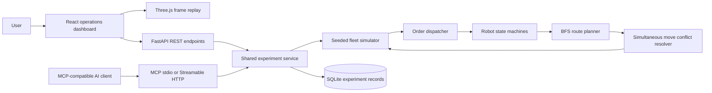
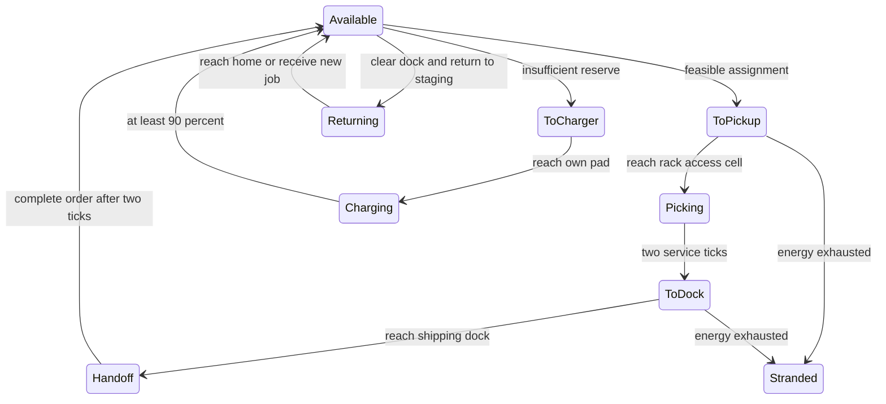

# Architecture

## Robot lifecycle

## Coordination and invariants

Robots are independent stateful agents under a shared dispatch and movement coordinator. No robot teleports: each tick moves at most one orthogonal grid cell. Service and charging consume separate ticks. The dispatcher filters orders by release time and energy feasibility, then applies FIFO, nearest pickup, or a global auction heuristic.

Stable BFS paths avoid oscillations from constantly changing obstacles. Traffic waits trigger replanning around occupied cells; recent-cell exclusions detect and escape repeated movement cycles. The movement resolver handles duplicate destination claims, forbids head-on two-robot swaps, and propagates blocking from stationary robots. Following into a cell that is vacated simultaneously is allowed. All final positions are checked against rack/maintenance obstacles and cell exclusivity in production.

An aisle closure never activates under an occupied robot. Such cells are retried as robots vacate them. The model does not claim a global deadlock-free guarantee; a bounded run reports partial completion honestly. Each order's pickup/handoff events precede its final completion record.

## Reproducibility and persistence

Order generation depends on scenario, count, and seed, not the dispatch policy. Comparison runs share initial order demand, batteries, layout, and fleet parameters. No mutable robot/order state is shared across runs. SQLite stores full JSON results plus lightweight summaries; grouped comparisons save atomically. The dashboard and MCP processes use the same absolute project-relative database path.

The frontend never calculates success metrics. It displays saved frame counters and final metrics. Its interpolator moves robot meshes between adjacent backend snapshots, preserving following-robot spacing; seeking resets interpolation. Heatmap overlays are full-run aggregates. Three.js geometry, textures, materials, observers, and controls are cleaned up on unmount, and rendering pauses when the viewport or document is hidden. A 2D snapshot renderer remains available if WebGL fails.
